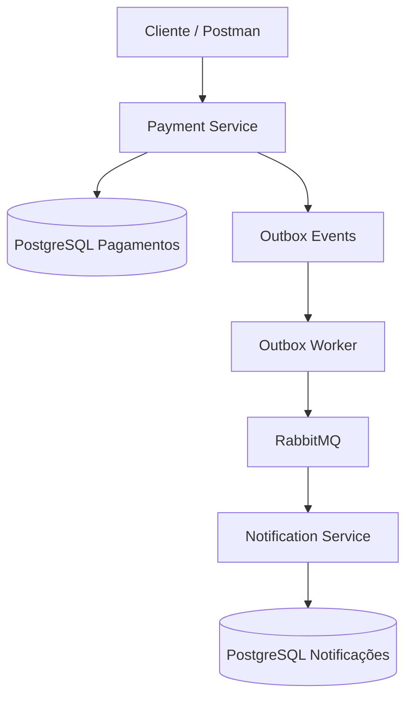

# CompreFácil

Sistema acadêmico de processamento de pagamentos utilizando arquitetura de microsserviços, comunicação assíncrona e persistência de dados.

## 1. Objetivo

O CompreFácil demonstra a integração entre microsserviços independentes para processamento de pagamentos e envio de notificações.

O projeto utiliza comunicação assíncrona por mensageria, permitindo reduzir o acoplamento entre os serviços e melhorar a resiliência da aplicação.

## 2. Arquitetura

O sistema possui dois microsserviços:

- Payment Service: recebe solicitações, registra pagamentos e publica eventos.
- Notification Service: consome eventos e persiste notificações.

### Fluxo de comunicação



## 3. Tecnologias utilizadas

- Node.js
- JavaScript
- Express
- PostgreSQL
- RabbitMQ
- Docker e Docker Compose
- amqplib
- node-postgres (pg)
- dotenv
- Node.js Test Runner

## 4. Estrutura do projeto

```text
CompreFacil/
│
├── payment-service/
│   ├── src/
│   │   ├── database/
│   │   │   └── db.js
│   │   ├── messaging/
│   │   │   └── rabbitmq.js
│   │   ├── workers/
│   │   │   └── outbox.js
│   │   └── app.js
│   └── package.json
│
├── notification-service/
│   ├── src/
│   │   ├── database/
│   │   │   └── db.js
│   │   ├── messaging/
│   │   │   └── consumer.js
│   │   └── app.js
│   └── package.json
│
├── tests/
│   └── integration.test.js
│
├── docker-compose.yml
├── package.json
├── .gitignore
└── README.md
```

## 5. Bancos de dados

O projeto utiliza bancos PostgreSQL separados.

### Payment Service
- Database: comprefacil
- Porta: 5432
- Tabela: payments
- Tabela: outbox_events

### Notification Service
- Database: notifications
- Porta: 5433
- Tabela: notifications

A separação permite que cada microsserviço mantenha a responsabilidade pelos próprios dados.

## 6. Mensageria

O RabbitMQ realiza a comunicação assíncrona entre os serviços.

Exchange:
- Nome: payment.events
- Tipo: topic

Eventos utilizados:
- payment.received
- payment.confirmed

Fila:
- notification.events

O consumidor utiliza confirmação ACK após a persistência da notificação.

## 7. Outbox Pattern

O Payment Service utiliza o padrão Outbox para garantir que o registro do pagamento e o registro do evento sejam realizados na mesma transação PostgreSQL.

Um worker consulta os eventos pendentes e tenta publicá-los no RabbitMQ.

Quando a publicação é confirmada:
- O campo published_at é preenchido.
- O evento deixa de ser considerado pendente.

Em caso de falha:
- O evento permanece armazenado.
- A tentativa é registrada.
- O erro é armazenado.
- Uma nova tentativa é programada com intervalo progressivo.

## 8. Como executar o projeto

### Pré-requisitos

- Node.js instalado.
- npm instalado.
- Docker Desktop instalado e iniciado.

### Etapa 1 - Iniciar a infraestrutura

Na raiz do projeto:

```powershell
docker compose up -d
```

Verificar os containers:

```powershell
docker compose ps
```

### Etapa 2 - Instalar dependências

Payment Service:

```powershell
cd payment-service
npm install
```

Notification Service:

```powershell
cd notification-service
npm install
npm install pg
```

### Etapa 3 - Iniciar os microsserviços

Terminal 1:

```powershell
cd C:\Projetos\CompreFacil\notification-service
npm run dev
```

Terminal 2:

```powershell
cd C:\Projetos\CompreFacil\payment-service
npm run dev
```

## 9. Endpoints

### Payment Service

Verificar disponibilidade:

GET http://localhost:3001/health

Criar pagamento:

POST http://localhost:3001/payments

Consultar pagamento:

GET http://localhost:3001/payments/:id

Exemplo de requisição:

```json
{
  "customerName": "João da Silva",
  "customerEmail": "joao@email.com",
  "amount": 249.90
}
```

### Notification Service

Verificar disponibilidade:

GET http://localhost:3002/health

Consultar notificações:

GET http://localhost:3002/notifications

Consultar notificações por pagamento:

GET http://localhost:3002/notifications/:paymentId

## 10. Testes automatizados

O projeto utiliza o test runner nativo do Node.js.

Executar na raiz:

```powershell
node --test tests/integration.test.js
```

Os testes verificam:
- Disponibilidade dos microsserviços.
- Validação de dados.
- Criação de pagamentos.
- Confirmação dos pagamentos.
- Persistência das notificações.

## 11. Teste de recuperação

O sistema permite simular indisponibilidade do RabbitMQ:

```powershell
docker compose stop rabbitmq
```

Os eventos continuam registrados na tabela Outbox.

Para restaurar:

```powershell
docker compose start rabbitmq
```

O Payment Service tenta publicar os eventos pendentes novamente.

O Notification Service deve estar conectado ao RabbitMQ para consumir as mensagens. Caso sua conexão tenha sido encerrada durante a indisponibilidade, reinicie o serviço.

## 12. Painel RabbitMQ

Acessar:

http://localhost:15672

Credenciais locais de desenvolvimento:

- Usuário: comprefacil
- Senha: comprefacil123

## 13. Considerações finais

O projeto demonstra conceitos fundamentais de sistemas distribuídos:

- Arquitetura de microsserviços.
- Independência entre serviços.
- Persistência de dados.
- Comunicação assíncrona.
- Produção e consumo de mensagens.
- Roteamento de eventos.
- Confirmação de mensagens.
- Idempotência.
- Outbox Pattern.
- Tratamento de falhas.
- Testes automatizados.

O processamento de pagamentos utilizado nesta implementação é uma simulação acadêmica, sem integração com instituições financeiras ou gateways reais.
